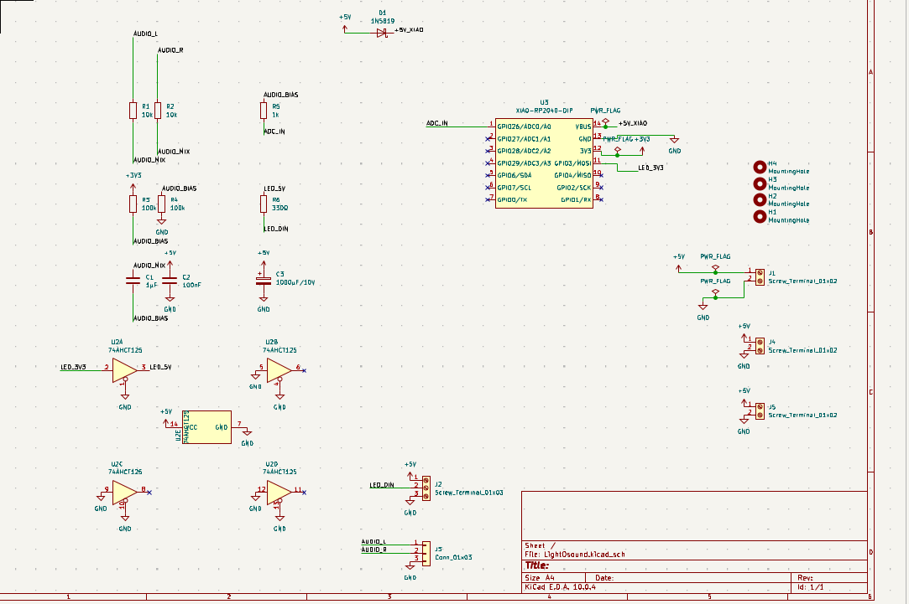
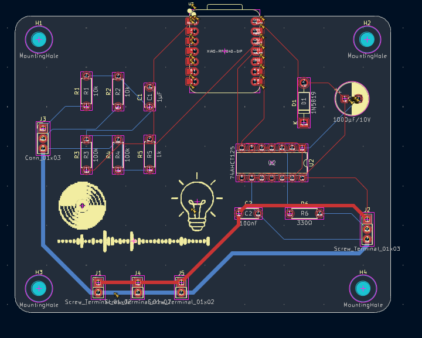
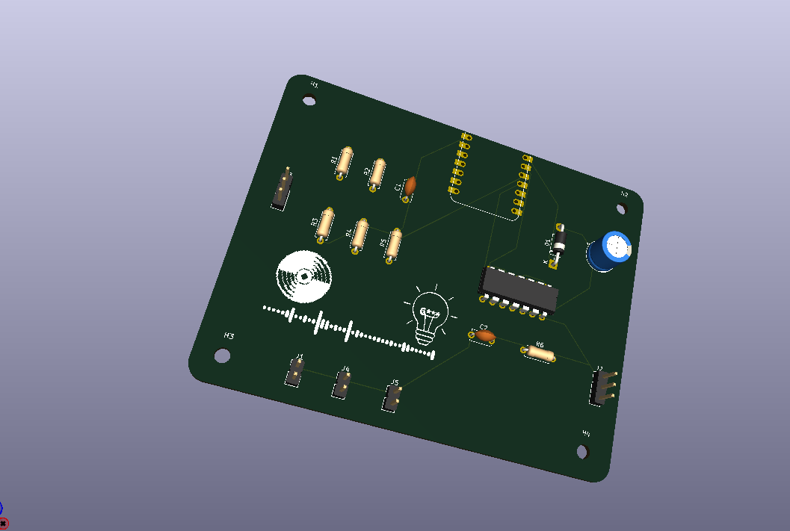

# Light-O-Sound
# Speaker or light? why not both!

# What does this project do?
this is a music reacting lightstrip, AND a bluetooth speaker in one!

# How does it work?
basically, it reads input, which reacts to the sound. so even if you latency is high, it will still sync perfectly with both the bluetooth and light.

# Why have i made this?
ive always wanted this to be honest, i also made this for half life hack club program.

schematic:

pcb:

3d (somewhat):

# Firmware setup
Install the Adafruit NeoPixel library using the Arduino IDE Library Manager. The VS Code C/C++ configuration expects it in the default Arduino libraries folder (`~/Arduino/libraries/Adafruit_NeoPixel`). If your Arduino sketchbook uses a different location, update the library path in `.vscode/c_cpp_properties.json`.
